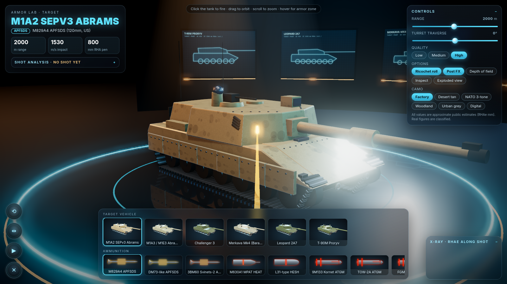
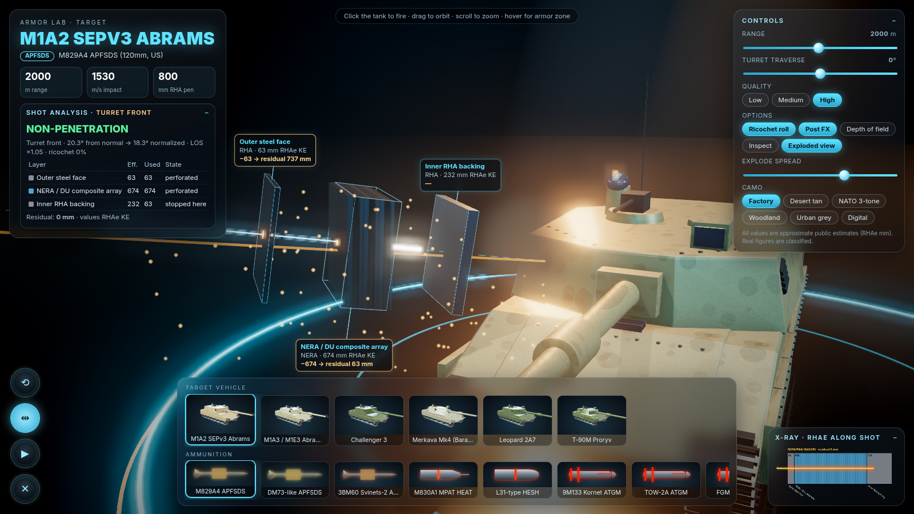

# Tank Armor Lab: 3D armor / shell simulator (PWA)

A self-contained browser simulator for tank armor and ammunition, styled as a dark sci-fi "lab" showroom. It uses Three.js r170, vendored in `vendor/` (no CDN). Everything runs client-side and works offline once it has been installed as a PWA.




## Features
- **Tanks**: M1A2 SEPv3, M1A3/M1E3 (**speculative**: the vehicle is unreleased and its data is guessed), Challenger 3, Merkava Mk4, Leopard 2A7, T-90M. All are procedural models with beveled plates, bolts, ERA tiles, instanced track links and edge highlights. Six camo schemes with procedural wear.
- **Lab scene**: a reflective stage with a softened mirror, cyan/amber rim rings, backlit wall panels with tank silhouettes, light shafts, warm/cool spot lights and a custom HDR-like environment. Post-processing adds SSAO (GTAO), bloom, an optional depth of field and a vignette.
- **Armor zones**: turret front, side, rear and roof; hull UFP, LFP, side, skirt, roof and rear. Each zone has layered RHA / composite / NERA / ERA / spaced / structure layers with separate **KE** and **CE** RHA-equivalent values.
- **Ammunition**: M829A4, DM73-like and 3BM60 APFSDS; M830A1 HEAT; L31-type HESH; Kornet, TOW-2A and Javelin (top-attack) tandem ATGMs.
- **Ballistics model**:
  - Impact angle is measured against the true surface normal.
  - Long-rod rounds get normalization, and armor thickness scales with line of sight.
  - Ricochet and fuze-failure chances rise with angle.
  - ERA weakens single-charge HEAT; a tandem round's precursor charge sets the ERA off first.
  - HESH is defeated by spaced armor and composite, and causes spall on bare plate.
  - APFSDS velocity and penetration fall off with range.
- **Exploded armor view**: the layers of the struck zone separate along the shot axis as 3D slabs (translucent ceramic/composite, metal RHA, NERA sandwich, ERA bricks, dashed air gaps). Each slab has a cyan callout, the penetrator's path is animated through them, and the residual penetration is shown after each layer.
- **HUD**: glassmorphism title card, shot analysis, a controls panel with pill toggles, an X-ray cutaway chart, filmstrip carousels of tanks (rendered thumbnails) and shells, circular buttons, and cinematic camera moves.
- **Mobile / PWA**:
  - Touch controls: tap to fire, drag to orbit, pinch to zoom, long-press for zone info.
  - Responsive portrait and landscape layouts that respect iPhone safe areas.
  - Phones default to Low quality.
  - The service worker caches everything for offline use.

> **Armor and penetration values are rough public estimates** taken from open sources. Real figures are classified. This is an educational toy, not an accurate model.

## Run locally
ES modules need HTTP, so the page won't run if you open the file directly:
```bash
cd tanksim && python3 -m http.server 8000
# open http://localhost:8000
```
On an iPhone, open the page over HTTPS in Safari, then tap Share → **Add to Home Screen**.

## Deploy to GitHub Pages
1. Create a GitHub repo and push this folder (`git remote add origin … && git push -u origin main`).
2. In the repo, go to **Settings → Pages → Build and deployment**, set **Source: Deploy from a branch**, then choose **Branch: main / (root)**.
3. The site is served at `https://<user>.github.io/<repo>/`. All paths are relative, so it works from a subpath. Pages serves over HTTPS, so the PWA and service worker work.
4. After changing any files, bump `CACHE` in `sw.js` (e.g. `tanksim-v3`) so installed clients update.

## Files
`index.html` (UI/CSS) · `main.js` (app, picking, FX, HUD) · `lab.js` (environment) · `models.js` (procedural tanks) · `exploded.js` (exploded view) · `thumbs.js` (thumbnails) · `ballistics.js` · `data.js` (armor/shell data) · `sw.js` · `manifest.json` · `icons/`

Note: `vendor/jsm/postprocessing/GTAOPass.js` is patched so that sprites, particles and FX meshes are skipped in the AO normal pass.
